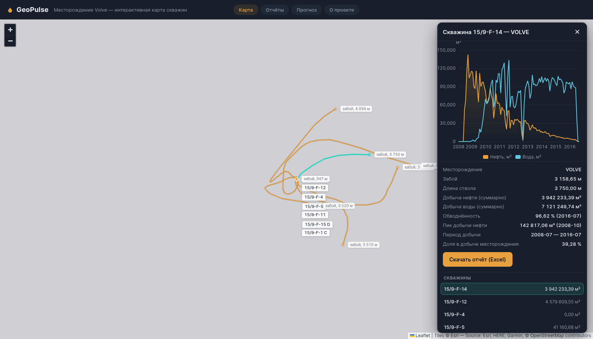

# GeoPulse

[](https://github.com/azamat-davletbaev/GeoPulse/actions/workflows/ci.yml)
[](https://github.com/azamat-davletbaev/GeoPulse/actions/workflows/deploy.yml)

GeoPulse — демонстрационная веб-система мониторинга добычи нефти на открытых данных месторождения **Volve** (норвежский шельф, Северное море). Данные импортируются событийным пайплайном через Apache Kafka, точечные показатели хранятся в PostgreSQL, сырые события и помесячные агрегаты — в ClickHouse. Поверх этого работает REST API и статический веб-клиент: интерактивная карта скважин с траекториями стволов, графики добычи по скважине и месторождению, отчёты в Excel и CSV. Весь стек поднимается одной командой `docker compose up -d --build`, деплой на сервер — через GitHub Actions и Caddy с автоматическим TLS.



## Стек

- **.NET 10** — ASP.NET Core Web API (`GeoPulse.WebAPI`) и четыре консольных сервиса
- **PostgreSQL 17** — справочник скважин, суточная добыча, координаты устьев, траектории, забой
- **ClickHouse 24.8** — сырые суточные события (`ReplacingMergeTree`) и помесячные агрегаты (`MergeTree`)
- **Apache Kafka 4.0** (KRaft, один узел) — шина между импортом и двумя потребителями, DLQ для ошибок
- **EF Core 10** + `Npgsql` — модель PostgreSQL и миграции
- **ClickHouse.Client**, **Confluent.Kafka**, **ExcelDataReader**, **ClosedXML**, **Swashbuckle**
- **Leaflet** + **ECharts** — карта и графики (локальные vendor-файлы, без CDN)
- **Docker Compose**, **Caddy 2.8** (авто-HTTPS), **GitHub Actions** (CI/CD, образы в ghcr.io)

## Возможности

- **Карта скважин**: устья, линии траекторий стволов и забои; выбор скважины кликом по любому из объектов или строкой списка.
- **Панель скважины**: помесячный график добычи нефти и воды и сводка — суммарные нефть и вода, обводнённость, пик добычи, период работы, доля в добыче месторождения, глубина забоя и длина ствола.
- **Отчёты**: сводка и график по месторождению, выгрузка `monthly.xlsx` (листы «Сводка», «Помесячно», «По скважинам»), `monthly.csv` и персональный отчёт по скважине `wells/{wellId}.xlsx`.
- **REST API**: скважины, карточка скважины, страница суточной добычи с фильтром по датам и пагинацией, траектория в WGS84, аналитика из ClickHouse, Swagger, `/health`.
- **Событийный импорт**: Excel + текстовые выгрузки WITSML → Kafka → PostgreSQL/ClickHouse, идемпотентная запись, DLQ с причинами отказов.
- **Эксплуатация**: `docker compose`-стек с healthcheck'ами, деплой по SSH с health-gate и откатом по тегу образа, скрипт бэкапа PostgreSQL.

## Архитектура

```
Excel + WITSML-текст ──▶ Ingestion.Service ──▶ Kafka "production-daily"
                                                  ├─▶ Consumer  ──▶ PostgreSQL (точечные данные)
                                                  ├─▶ CHIngest  ──▶ ClickHouse gp (сырые события)
                                                  └─▶ "production-daily-dlq" (ошибочные события)

ClickHouse gp.production_daily ──▶ Aggregator (таймер 60 с) ──▶ gp.monthly_production
PostgreSQL public.* + ClickHouse gp.monthly_production ──▶ WebAPI ──▶ web/ (Leaflet + ECharts) ──▶ Caddy
```

Подробно — сервисы, обоснование двух хранилищ, формат сообщений и партиционирование: [docs/architecture.md](docs/architecture.md).

## Быстрый старт

```bash
git clone https://github.com/azamat-davletbaev/GeoPulse.git
cd GeoPulse
docker compose up -d --build
dotnet run --project src/GeoPulse.Ingestion.Service   # первичный импорт данных
```

Приложение: <http://localhost:5146/> (Swagger — `/swagger`, Kafka UI — <http://localhost:8080>).

Пошаговая инструкция с нуля (требования, переменные `.env`, миграции, заполнение ClickHouse, тесты) — в [docs/development.md](docs/development.md).

## Документация

| Документ | О чём |
| --- | --- |
| [docs/architecture.md](docs/architecture.md) | поток данных, роли сервисов, почему PostgreSQL и ClickHouse, Kafka как шина, формат сообщений |
| [docs/domain.md](docs/domain.md) | предметная область, схемы PostgreSQL и ClickHouse, топики, датасет Volve, формулы |
| [docs/development.md](docs/development.md) | локальный запуск с нуля, структура solution, тесты |
| [docs/runbook.md](docs/runbook.md) | эксплуатация: команды на сервере, деплой, откат, диагностика, бэкапы |
| [docs/features.md](docs/features.md) | функции веб-интерфейса, все API-эндпоинты, расчёт метрик |
| [DEPLOY.md](DEPLOY.md) | подготовка VPS и первый деплой (ручные шаги) |

## Данные и лицензия

Используется открытый набор **Volve** от Equinor под **Equinor Open Data Licence** (CC BY-NC-SA 4.0), источник — <https://www.equinor.com/energy/volve-data-sharing>. В репозитории лежат только две части набора: `data/Volve_Production_data/` (суточная добыча) и `data/Volve_Well_technical_data/WellWellbore/` (траектории); текст лицензии — `data/Volve_Production_data/license.txt`. На код репозитория лицензия данных не распространяется.

## Открытые вопросы

1. **Скриншот.** В разделе описания стоит заглушка `docs/img/screenshot.png` — файла и каталога `docs/img/` в репозитории пока нет (готовые скриншоты лежат в `docs/screenshots/`). [УТОЧНИТЬ], какой снимок станет основным.
2. **Ссылка на демо.** Публичный адрес развёрнутого стенда в README не указан (домен задаётся в `.env` как `DOMAIN`) — [УТОЧНИТЬ].
3. **Страница «Прогноз».** Пункт меню и страница `web/forecast.html` есть, но `/api/Forecast/*` в WebAPI не реализован: страница показывает «Прогноз недоступен». Выносить ли её из навигации до появления ML-сервиса — [УТОЧНИТЬ].
