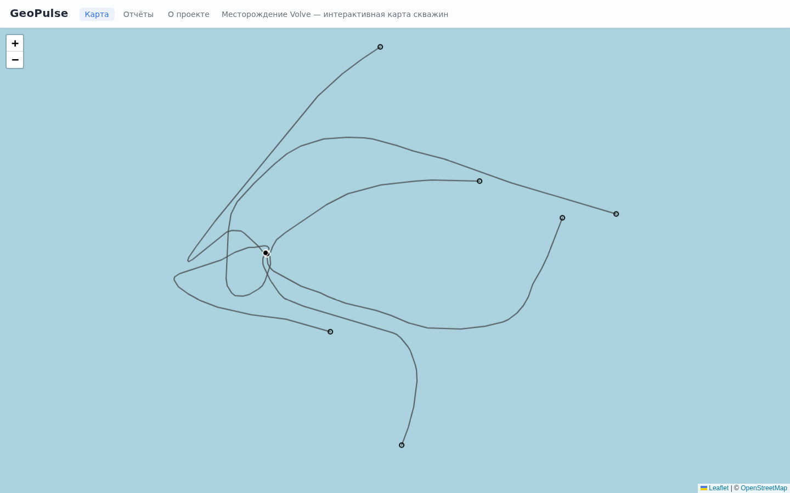
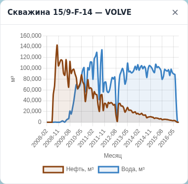

# GeoPulse

[](https://github.com/azamat-davletbaev/GeoPulse/actions/workflows/ci.yml)

Веб-система мониторинга добычи нефти: импорт суточных показателей скважин через событийный пайплайн (Apache Kafka), хранение в PostgreSQL и ClickHouse, выдача точечных данных и аналитики через REST API. Демонстрационный кейс построен на открытых данных месторождения **Volve** (норвежский шельф, Северное море).

**Стек:** .NET 10, ASP.NET Core Web API, PostgreSQL, ClickHouse, Apache Kafka, EF Core, Docker Compose.

## Данные проекта

Проект использует открытый набор данных Volve, опубликованный компанией Equinor (Норвегия) под **Equinor Open Data Licence** (CC BY-NC-SA 4.0). Источник — <https://www.equinor.com/energy/volve-data-sharing>.

Полный набор — около 40 000 файлов общим объёмом более 4 ТБ; качать целиком не нужно. Для работы достаточно двух частей, которые хранятся в репозитории (единицы МБ) и запекаются в образ `geopulse-ingestion` (см. `DEPLOY.md`):

```
data/Volve_Production_data/Volve production data.xlsx
data/Volve_Well_technical_data/WellWellbore/**
```

Остальные части набора (EDM.XML, отчёты бурения HTML/PDF/XML — порядка 385 МБ) парсером не используются и в репозиторий не входят (`.gitignore`/`.dockerignore`).

Пути к данным заданы в `src/GeoPulse.Ingestion.Service/appsettings.json` (`Volve:ProductionWorkbook`, `Volve:WellboreRoot`).

## Архитектура

Пайплайн данных:

```
Excel ──▶ Ingestion.Service ──▶ Kafka (production-daily) ──┬─▶ GeoPulse.Consumer ──▶ PostgreSQL (точечные данные)
              парсер+издатель        лента событий          ├─▶ GeoPulse.CHIngest ──▶ ClickHouse gp (сырые события)
                                                            └─▶ production-daily-dlq (некорректные события)

ClickHouse gp.production_daily ──▶ GeoPulse.Aggregator (таймер 60 с) ──▶ ClickHouse gp.monthly_production
ClickHouse gp.monthly_production ──▶ GeoPulse.WebAPI (/api/Analytics/*)
```

| Проект | Назначение |
| --- | --- |
| `src/GeoPulse.Core` | Доменные модели (`Well`, `DailyProduction`) и модели событий (`Events/`). Зависимостей от инфраструктуры нет. |
| `src/GeoPulse.Infrastructure` | EF Core: `CoreDbContext`, сущности, конфигурация, миграции, репозитории. Таблицы `wells`, `daily_production`, `well_locations`, `well_trajectories` (PK `well_id + md`), `well_trajectory_meta` (PK `well_id`, забой TD) в схеме `public` (у `daily_production` уникальный индекс `well_id + date`, у `well_locations` — PK `well_id` и координаты устья WGS84). Схема `analytics` (`analytics.monthly_production`) заморожена: это снимок помесячных агрегатов для сверок, код её не читает и не пишет. |
| `src/GeoPulse.Ingestion.Service` | Консольный парсер: Excel Volve + текстовые траектории WITSML (`WellWellbore/**/*_ACTUAL`) → Kafka. В PostgreSQL не пишет. Публикует сначала события `well.registered` (по одному на скважину), затем `well.trajectory` (по одному на ствол, замеры ED50/UTM31N + забой Bottom Hole MD/TVD), затем `production.daily` на каждую строку добычи. Ключ сообщений — строка `npdWellBoreCode` (сохраняет порядок событий в пределах скважины). |
| `src/GeoPulse.Consumer` | Консольный BackgroundService: слушает топик `production-daily` (группа `geopulse-consumer`), применяет EF-миграции на старте, пишет события в PostgreSQL идемпотентно (`INSERT ... ON CONFLICT DO NOTHING` для добычи и замеров траектории, upsert для забоя). Некорректные события (битый JSON, неизвестный `eventType`, неподдерживаемая `schemaVersion`, неизвестная скважина) отправляет в топик `production-daily-dlq` с оригинальным телом и заголовком `reason`. |
| `src/GeoPulse.CHIngest` | Консольный BackgroundService — второй читатель топика `production-daily` (группа `geopulse-chingest`). Пишет сырые события в ClickHouse (база `gp`, таблицы `wells` и `production_daily`, движок `ReplacingMergeTree`, чтение через `FINAL`): дубли топика дедуплицируются средствами движка, без дедупликации в памяти, запись — батчами по `Kafka:BatchSize`. События `well.trajectory` распознаёт и пропускает (геометрия — не таймсерия, в ClickHouse не пишется). Справочник `npdWellBoreCode → well_id` кэшируется на старте из PostgreSQL (`ConnectionStrings:CoreDb`). Некорректные события (битый JSON, неизвестный `eventType`, неподдерживаемая `schemaVersion`, неизвестная скважина) отправляет в `production-daily-dlq` с заголовком `reason`, как и Consumer (причины: у CHIngest неизвестная скважина — `unknown.well`, у Consumer — `well.not.found`). |
| `src/GeoPulse.WebAPI` | REST API + Swagger, порт `5146`. Точечные данные из PostgreSQL: список скважин (с `tdMd`/`tdTvd` забоя), карточка скважины, суточная добыча с фильтром по датам, сортировкой и пагинацией, траектория ствола (`GET /api/wells/{wellId}/trajectory`, замеры в WGS84), health-проверка. Аналитика — из ClickHouse через `ClickHouseAnalyticsService`: помесячные агрегаты одной скважины и суммарная добыча по всем скважинам одним SQL-запросом к `gp.monthly_production`. Отчёты — `ReportService` (Excel через ClosedXML, CSV без библиотек), контроллер `ReportsController`. Список скважин включает координаты устья из `well_locations` (JOIN). Раздаёт статический фронт `web/` (`UseDefaultFiles` + `UseStaticFiles`). |
| `src/GeoPulse.Aggregator` | Консольный BackgroundService, Kafka не использует. На старте и далее по таймеру `RecalcIntervalSeconds` (по умолчанию 60 с) полностью пересобирает `gp.monthly_production` из `gp.production_daily FINAL`: `TRUNCATE` + `INSERT ... SELECT` с группировкой по `well_id`, году и месяцу. Состояния в памяти нет, поэтому повторные пересборки результат не меняют. Окно между `TRUNCATE` и вставкой — см. «Известные ограничения». |

### Схема событий (schemaVersion: 1)

Издатель — `Ingestion.Service`, потребители — `GeoPulse.Consumer` (PostgreSQL) и `GeoPulse.CHIngest` (ClickHouse). Оба проверяют заголовок события (тип и версию схемы) и отправляют некорректные сообщения в DLQ.

- `well.registered` — регистрация/апсерт скважины: `data: { npdWellBoreCode, name, field, type }`.
- `production.daily` — суточная добыча: `data: { npdWellBoreCode, date, onStreamHrs, avgDownholePressure, avgDownholeTemperature, avgDpTubing, avgAnnulusPressure, avgChokeSize, avgWhp, avgWht, dpChokeSize, oilVol, gasVol, waterVol, waterInjectionVol }`.

В событиях нет внутренних id из БД — только натуральный ключ `npdWellBoreCode`; читатели резолвят его в `well_id` (Consumer — при записи в PostgreSQL, CHIngest — через кэш скважин). Внутренний `wellId` в событиях появляться не должен.

Топики: `production-daily` (3 партиции; группы `geopulse-consumer` и `geopulse-chingest`), `production-daily-dlq` (1 партиция).

## Инфраструктура (docker compose)

Сервисы (имена контейнеров с префиксом `geopulse-`): `postgres` (`geopulse-postgres`, localhost:5432, БД `geopulse_core`), `kafka` (`geopulse-kafka`; внешне localhost:9092, внутри compose-сети `kafka:29092`; бинари CLI — в `/opt/kafka/bin/`, не в PATH), `kafka-ui` (`geopulse-kafka-ui`, <http://localhost:8080>), `clickhouse` (`geopulse-clickhouse`, HTTP 8123, база `gp`), `consumer` (`geopulse-consumer`, слушает `production-daily`), `webapi` (`geopulse-webapi`, порт 5146). Healthcheck объявлен у `postgres` и `clickhouse` — по нему `webapi` ждёт готовности баз; у `kafka`, `kafka-ui` и `consumer` healthcheck нет, они просто запускаются.

Строки подключения: `ConnectionStrings:CoreDb` — Consumer и CHIngest (PostgreSQL); `ConnectionStrings:GeoPulse` — WebAPI (PostgreSQL); `ConnectionStrings:ClickHouse` — WebAPI (ClickHouse); `ClickHouse:ConnectionString` — CHIngest и Aggregator (ClickHouse). База ClickHouse во всех строках — `gp`.

## Канонические имена

Значения, которые должны совпадать в compose, `appsettings*.json` и коде.

| Сущность | Значение |
| --- | --- |
| PostgreSQL: база | `geopulse_core` (пользователь/пароль `geopulse`/`geopulse`) |
| PostgreSQL: схема данных | `public` (`wells`, `daily_production`, `well_locations`); схемы `data` нет |
| PostgreSQL: схема аналитики | `analytics` (`monthly_production`) — заморожена, справочный снимок |
| ClickHouse: база | `gp` (`wells`, `production_daily`, `monthly_production`); SQL — с полным именем `gp.<таблица>` |
| Kafka: топики | `production-daily` (3 партиции), `production-daily-dlq` (1 партиция) |
| Kafka: группы консьюмеров | `geopulse-consumer` (Consumer), `geopulse-chingest` (CHIngest) |
| Контейнеры | `geopulse-postgres`, `geopulse-clickhouse`, `geopulse-kafka`, `geopulse-kafka-ui`, `geopulse-consumer`, `geopulse-webapi` |
| Порты | PostgreSQL `5432`, ClickHouse HTTP `8123` (нативный `9000`), Kafka `9092` снаружи / `29092` внутри compose, WebAPI `5146`, kafka-ui `8080` |
| Схема событий | `schemaVersion: 1`; `eventType`: `well.registered`, `production.daily`, `well.trajectory` |

## Запуск

Из корня репозитория.

1. Поднять контейнеры:

   ```bash
   docker compose up -d
   ```

2. При первом старте (или если топиков нет) — создать топики:

   ```bash
   docker exec geopulse-kafka /opt/kafka/bin/kafka-topics.sh --bootstrap-server localhost:9092 --create --topic production-daily --partitions 3 --replication-factor 1
   docker exec geopulse-kafka /opt/kafka/bin/kafka-topics.sh --bootstrap-server localhost:9092 --create --topic production-daily-dlq --partitions 1 --replication-factor 1
   ```

3. Запустить консьюмер PostgreSQL (он применяет EF-миграции и начинает слушать топик):

   ```bash
   dotnet run --project src/GeoPulse.Consumer
   ```

4. Запустить CHIngest — второй читатель того же топика (создаёт базу `gp` и таблицы ClickHouse):

   ```bash
   dotnet run --project src/GeoPulse.CHIngest
   ```

5. Запустить импорт (публикует события в Kafka; Excel-файл должен быть уже скачан — см. «Данные проекта»):

   ```bash
   dotnet run --project src/GeoPulse.Ingestion.Service
   ```

6. Запустить агрегатор (пересобирает `gp.monthly_production` на старте и далее каждые 60 с):

   ```bash
   dotnet run --project src/GeoPulse.Aggregator
   ```

7. Проверка: карта — <http://localhost:5146/>, Swagger — <http://localhost:5146/swagger> (`GET /api/wells` — список скважин с координатами, `GET /api/wells/5351/production?pageSize=20` — суточная добыча, `GET /health` — состояние API и БД, `GET /api/Analytics/summary` — суммарная добыча из ClickHouse), kafka-ui: <http://localhost:8080>. Данные в ClickHouse:

   ```bash
   docker exec geopulse-clickhouse clickhouse-client --query "SELECT count() FROM gp.production_daily FINAL"
   docker exec geopulse-clickhouse clickhouse-client --query "SELECT count() FROM gp.monthly_production"
   ```

   Полная проверка API — смок-тест из раздела «Смок-тест API».

Порядок важен: сначала оба читателя (Consumer, CHIngest), затем Ingestion; агрегатор можно запускать в любой момент — он пересчитывает агрегаты по таймеру. Повторный запуск Ingestion безопасен: события уже в базах, консьюмер покажет «вставлено 0, пропущено N», а ClickHouse дедуплицирует дубли средствами `ReplacingMergeTree` (чтение через `FINAL`). Данные между Kafka и хранилищами — at-least-once; идемпотентность записи в PostgreSQL и движок ClickHouse компенсируют возможные дубликаты. WebAPI в compose поднимается автоматически; для локального запуска — `dotnet run --project src/GeoPulse.WebAPI` (порт 5146).

Координаты устьев скважин (для карты) заполняются отдельным идемпотентным сидом после загрузки скважин (шаг 5):

```bash
docker exec -i geopulse-postgres psql -U geopulse -d geopulse_core < sql/seed_well_locations.sql
```

Повторный запуск безопасен: `ON CONFLICT DO UPDATE` по `well_id` оставляет ровно 7 строк в `well_locations`.

## Веб-клиент (карта, панель, отчёты)

Фронт — статика из `web/`, раздаётся самим WebAPI. Leaflet 1.9.4 и Chart.js 4.4.1 лежат локально в `web/vendor/` (без CDN), иконка вкладки — `web/favicon.ico` (16/32/48/64 px, та же символика: голубая траектория, залитая точка устья, незалитый кружок забоя).

Карта: семь тёмно-серых траекторий (линии по возрастанию MD), залитые чёрные устья в белой обводке и незалитые кружки забоев. Первичный вид — `fitBounds` по устьям и траекториям с ограничителем `maxZoom`.



Панель скважины: помесячный график добычи — нефть коричневая, вода голубая.



## Смок-тест полного цикла

После полного прогона: в `daily_production` — 15 634 записи без дублей (`COUNT(DISTINCT (well_id, date))` = 15 634), в `wells` — 7 скважин, отставание групп консьюмеров (`geopulse-consumer`, `geopulse-chingest`) — 0 по всем партициям, DLQ пуста. Проверка API на этих же данных — смок-тест из раздела «Смок-тест API».

Контрольные числа этапа 4:

| Проверка | Значение |
| --- | --- |
| `SELECT count() FROM gp.production_daily FINAL` | 15 634 |
| `SELECT count() FROM gp.wells FINAL` | 7 |
| `SELECT count() FROM gp.monthly_production` | 526 |
| `GET /api/Analytics/summary` → `totalOilVol` | ≈ 10 037 080.61 |
| Смок-тест API | 51 проверка из 51 |

## REST API: точечные данные и аналитика

API отдаёт точечные данные из PostgreSQL, а аналитику — из ClickHouse (`gp.monthly_production` через `ClickHouseAnalyticsService`). Адресация ресурсов — по натуральному ключу `npdWellBoreCode`; `wells.id` публикуется как `wellId` (список скважин, траектория, `/api/Analytics/monthly?wellId`, `/api/Reports/wells/{wellId}.xlsx`); `daily_production.id` наружу не публикуется.

| Метод и путь | Назначение |
| --- | --- |
| `GET /health` | Состояние API и подключения к PostgreSQL: `200` + `status=ok`, либо `503` + `status=degraded`, `database=down` |
| `GET /api/wells` | Список скважин с координатами устья: `wellId`, `npdWellBoreCode`, `name`, `field`, `type`, `latitude`, `longitude`, `tdMd`, `tdTvd` (JOIN `well_locations`) |
| `GET /api/wells/{npdWellBoreCode}` | Карточка скважины и покрытие данными: `firstProductionDate`, `lastProductionDate`, `productionDays` |
| `GET /api/wells/{npdWellBoreCode}/production` | Суточная добыча скважины: диапазон дат, сортировка, пагинация |
| `GET /api/wells/{npdWellBoreCode}/production/{date}` | Одна запись за дату (`yyyy-MM-dd`) |
| `GET /api/Analytics/monthly?wellId={id}` или `?wellCode={code}` | Помесячные агрегаты одной скважины из `gp.monthly_production` (ClickHouse); `wellCode` — `npdWellBoreCode` (прежний контракт), `wellId` — внутренний id |
| `GET /api/Analytics/summary` | Суммарная добыча по всем скважинам за всё время: один SQL-запрос к `gp.monthly_production` (ClickHouse) |
| `GET /api/Reports/monthly.xlsx` | Excel-отчёт по месторождению (ClosedXML): листы «Сводка», «Помесячно», «По скважинам»; `Content-Disposition: attachment`, имя файла с датой |
| `GET /api/Reports/monthly.csv` | Тот же помесячный набор в CSV (запятая, BOM, заголовки на английском), без внешних библиотек |
| `GET /api/Reports/wells/{wellId}.xlsx` | Excel-отчёт по одной скважине: листы «Скважина» (имя, месторождение, суммарные нефть/вода, период, доля) и «Помесячно»; `404` для неизвестного `wellId` |

Параметры выборки суточной добычи:

| Параметр | По умолчанию | Описание |
| --- | --- | --- |
| `from` | — | Начало диапазона дат включительно, `yyyy-MM-dd` |
| `to` | — | Конец диапазона дат включительно, `yyyy-MM-dd` |
| `page` | `1` | Номер страницы, не меньше 1 |
| `pageSize` | `100` | Размер страницы, 1..500 |
| `sort` | `desc` | Порядок по дате: `desc` — сначала новые, `asc` — по возрастанию |

Страница отдаётся конвертом: `items`, `totalCount`, `page`, `pageSize`, `totalPages`, `hasNextPage`, `hasPreviousPage`. Сортировка и `OFFSET/LIMIT` выполняются в SQL, `totalCount` считается отдельным запросом.

Ошибки — в формате ProblemDetails (`application/problem+json`): `400` — несогласованные или недопустимые параметры (`from` больше `to`, `pageSize` вне 1..500, неизвестный `sort`, неверная дата), `404` — нет скважины или записи за дату, `500` — необработанное исключение.

```bash
curl http://localhost:5146/health
curl http://localhost:5146/api/wells
curl http://localhost:5146/api/wells/5351
curl "http://localhost:5146/api/wells/5351/production?from=2016-01-01&to=2016-12-31&pageSize=50&sort=asc"
curl http://localhost:5146/api/wells/5351/production/2016-01-01
curl "http://localhost:5146/api/Analytics/monthly?wellCode=5351"
curl http://localhost:5146/api/Analytics/summary
```

## Смок-тест API

Повторяемая проверка API на заполненной базе: health, список и карточка скважины, пагинация, фильтр по датам, обе сортировки, запись за дату, траектория ствола (замеры в WGS84 и `404` для неизвестной скважины), ответы `400`/`404`, отчёты (сводный `monthly.xlsx` и персональный `wells/{wellId}.xlsx`), доступность Swagger.

```powershell
powershell -ExecutionPolicy Bypass -File tests/smoke/webapi-smoke.ps1 -BaseUrl http://localhost:5146
```

Скрипт печатает результат каждой проверки и завершается с кодом `1`, если есть проваленные проверки; успешный прогон — 51 проверка и сообщение «Все проверки пройдены: 51». `-ExecutionPolicy Bypass` нужен, если в системе запрещено выполнение локальных скриптов.

## Проверка фронтенда

Отдельная проверка клиентской логики `web/app.js` — без браузера и без Node.js на хосте (Node запускается в контейнере). Стенд `tests/frontend/webapp-check.js` подменяет Leaflet, DOM и `fetch` заглушками, повторяющими существенное поведение Leaflet (`L.latLng` бросает `Invalid LatLng object` на `NaN`/`undefined`), и прогоняет два сценария:

| Сценарий | Что проверяется |
| --- | --- |
| `mixed` | валидные и битые данные вперемешку: линия строится только по траекториям с двумя и более валидными точками, маркеры устьев — только по валидным координатам, `HTTP 500` по одной скважине не мешает остальным, `fitBounds` включает траектории и ограничен `maxZoom` |
| `empty` | валидных координат нет вовсе: `init` не падает, карта остаётся на нейтральном виде |

```powershell
powershell -ExecutionPolicy Bypass -File tests/frontend/run-webapp-check.ps1
```

Скрипт прогоняет оба сценария через `node:20-alpine` и завершается с кодом `1`, если хотя бы один сценарий провален. Проверка не входит в `dotnet test` (это не xUnit-тест) и запускается отдельным шагом CI (`frontend-check`).

Бэкенд проверяется обычным прогоном тестов — контрольное число `dotnet test` — 90 тестов:

```powershell
dotnet test tests/GeoPulse.Tests/GeoPulse.Tests.csproj -c Release
```

## Известные ограничения

- **Окно `TRUNCATE` → `INSERT` при пересборе `gp.monthly_production`.** Агрегатор сначала очищает таблицу, затем вставляет пересчитанные строки, поэтому в этот момент читатель может получить частичный агрегат (пустую или неполную таблицу). На объёме Volve окно занимает доли секунды; решение на будущее — атомарная подмена таблицы (`RENAME`/`EXCHANGE TABLES` на заранее заполненную копию).
- **ClickHouse не самодостаточен: справочник скважин резолвится через PostgreSQL.** CHIngest строит кэш `npdWellBoreCode → well_id` по таблице `wells` в PostgreSQL на старте; при расхождении справочников событие уходит в DLQ как `unknown.well`.
- **Kafka без volume.** У брокера нет persistent volume: после `docker compose down -v` топики и офсеты групп пропадают. Их нужно создавать заново (шаг 2 раздела «Запуск»), а читатели начнут с начала потока.
- **Локальный запуск CHIngest и Aggregator.** В прод-стеке (`docker-compose.prod.yml`) контейнеризованы все сервисы: `consumer`, `chingest`, `aggregator`, `webapi`, `caddy` + одноразовый `ingestion`; локально CHIngest и Aggregator можно запускать через `dotnet run`. Поэтому в их `appsettings.json` ClickHouse и PostgreSQL указаны как `localhost`; в контейнерах значения переопределяются переменными окружения (`ClickHouse__ConnectionString` с `Host=clickhouse`, `ConnectionStrings__CoreDb` с `Host=postgres`) и `depends_on` на готовность `postgres`/`clickhouse`.
- **Глубина забоя (TD) в попапе скважины.** Значения забоя (`Bottom Hole MD`/`TVD`) приходят из текстовых заголовков траекторий `data/Volve_Well_technical_data/WellWellbore/**`, хранятся в `well_trajectory_meta` и публикуются в `GET /api/wells` полями `tdMd`/`tdTvd`; попап показывает «Забой: … м» и «Длина ствола: … м».

## Этапы

| Этап | Статус | Итог |
| --- | --- | --- |
| 1. Каркас и модель данных | закрыт | Решение из 7 проектов в `src/`, доменные модели, схема PostgreSQL через EF Core, миграции. |
| 2. Пайплайн Kafka | закрыт | Ingestion публикует `well.registered` и `production.daily`; Consumer идемпотентно пишет в PostgreSQL; DLQ проверена. |
| 3. REST API | закрыт | Список и карточка скважины, суточная добыча с фильтрами, сортировкой и пагинацией, health, ProblemDetails, Swagger. |
| 4. Аналитика на ClickHouse | закрыт | CHIngest (сырые события в `gp`, `ReplacingMergeTree`, чтение `FINAL`) и Aggregator (пересборка `gp.monthly_production` по таймеру), `/api/Analytics/*` из ClickHouse. Контрольные числа: 15 634 строки добычи, 7 скважин, 526 агрегатов, `totalOilVol` ≈ 10 037 080.61. |
| 5. Веб-клиент с картой | закрыт | Статический фронт `web/` (Leaflet + Chart.js, раздаётся WebAPI), координаты устьев из WITSML (ED50→WGS84 EPSG:1613) в `well_locations`, `GET /api/wells` с `wellId`/`latitude`/`longitude`, `GET /api/Analytics/monthly?wellId`. При открытии страницы автоматически выбирается первая добывающая скважина (попап и панель с графиком открыты сразу); попап показывает суммарные нефть и воду, обводнённость последнего месяца с добычей, пик добычи, период работы и долю в добыче месторождения. |
| 6. Отчёты | закрыт | `GET /api/Reports/monthly.xlsx` (листы «Сводка», «Помесячно», «По скважинам», ClosedXML, жирная шапка, автоширина, формат `#,##0.00`) и `monthly.csv` (BOM, запятая). `ReportService` с юнит-тестами структуры xlsx (число листов, колонки, контрольная сумма). Дополнительно — `GET /api/Reports/wells/{wellId}.xlsx` (листы «Скважина», «Помесячно») и ссылка «Скачать отчёт (Excel)» в попапе скважины. Контроль: суммарная нефть ≈ 10 037 080.61. |
| 7. WITSML-данные | закрыт | Инжест геометрии скважин через ту же шину: Ingestion парсит текстовые выгрузки `WellWellbore/**/*_ACTUAL` (траектории, ED50/UTM31N) и публикует `well.trajectory`; Consumer пишет замеры в `well_trajectories` (PK `well_id+md`, reject дубликатов) и забой (Bottom Hole MD/TVD) в `well_trajectory_meta`. `GET /api/wells/{wellId}/trajectory` отдаёт замеры в WGS84 (EPSG:1613, общий хелпер `CoordinateTransform`); `GET /api/wells` дополнен `tdMd`/`tdTvd`; на карте слой линий траекторий и попап «Забой / Длина ствола». Перфораций в выгрузках нет — событие/таблица/эндпоинт перфораций не создаются. |
| 8. Деплой на VPS | закрыт | CI/CD через GitHub Actions (`.github/workflows/ci.yml` — build + test, `deploy.yml` — образы в `ghcr.io`), `docker-compose.prod.yml` (postgres/kafka/clickhouse/consumer/chingest/aggregator/webapi/caddy + одноразовый ingestion), Caddy c авто-HTTPS, `DEPLOY.md` (ufw, SSH по ключу, бэкап pg_dump), страница «О проекте», оформление карты (тёмно-серые траектории, чёрные устья/забои) и графиков (нефть — коричневая, вода — голубая), иконка вкладки `web/favicon.ico`, контакты разработчика на странице «О проекте» (блок под шапкой и краткая строка в подвале). |

## Лицензия данных

Данные Volve используются в соответствии с **Equinor Open Data Licence**. Текст лицензии — в наборе данных: `data/Volve_Production_data/license.txt`. На код репозитория лицензия данных не распространяется.