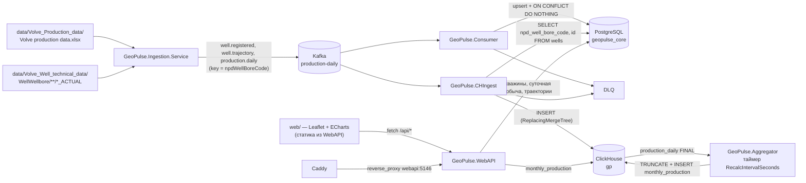

# Архитектура GeoPulse

Документ описывает фактическую архитектуру решения — только то, что реализовано в коде.

**Файлы-источники для этого раздела**

| Файл | Что взято |
| --- | --- |
| `docker-compose.yml`, `docker-compose.prod.yml` | состав сервисов, образы, порты, тома, healthcheck'и, лимиты памяти |
| `deploy.sh`, `scripts/bootstrap-server.sh` | порядок запуска, миграции, создание топиков, health-check |
| `src/GeoPulse.Ingestion.Service/IngestionService.cs`, `TrajectoryParser.cs`, `appsettings.json` | источник данных, что и в каком порядке публикуется |
| `src/GeoPulse.Consumer/ProductionConsumerService.cs`, `Program.cs` | чтение Kafka, SQL-запись в PostgreSQL, DLQ |
| `src/GeoPulse.CHIngest/CHIngestService.cs` | DDL ClickHouse, чтение Kafka, резолв `npdWellBoreCode → well_id` |
| `src/GeoPulse.Aggregator/AggregatorService.cs` | агрегация `production_daily → monthly_production` |
| `src/GeoPulse.WebAPI/*` (`Program.cs`, контроллеры, `ClickHouseAnalyticsService.cs`, `ReportService.cs`) | что читает API, из какого хранилища |
| `src/GeoPulse.Core/Events/*` | конверт и поля событий, `schemaVersion`, причины DLQ |
| `Caddyfile`, `.github/workflows/*.yml` | входная точка TLS и CI/CD |

## 1. Поток данных



Текстовый эквивалент (для терминала):

```
Excel + WITSML-текст
        │
        ▼
Ingestion.Service ──► Kafka "production-daily" ──┬──► Consumer ──► PostgreSQL geopulse_core
                                                  ├──► CHIngest ──► ClickHouse gp
                                                  └──► "production-daily-dlq" (ошибки)

ClickHouse gp.production_daily ──► Aggregator (таймер 60 с) ──► gp.monthly_production
ClickHouse gp.monthly_production ──► WebAPI (/api/Analytics/*, /api/Reports/*)
PostgreSQL public.* ──► WebAPI (/api/wells*)
```

## 2. Сервисы: что читает, что пишет, зачем существует

| Сервис | Читает | Пишет | Зачем существует |
| --- | --- | --- | --- |
| `GeoPulse.Ingestion.Service` | Excel `data/Volve_Production_data/Volve production data.xlsx` (лист `Daily Production Data`), текстовые файлы `data/Volve_Well_technical_data/WellWellbore/**/*_ACTUAL` | Kafka-топик `production-daily` | Единственное место, где разбирается «сырой» датасет Volve. В БД не пишет вообще: его задача — превратить файлы в события. Запускается одноразово (`profiles: ["init"]` в `docker-compose.prod.yml`, `docker compose run --rm ingestion`). |
| `GeoPulse.Consumer` | Kafka `production-daily` (группа `geopulse-consumer`), `Kafka:BatchSize` (по умолчанию 500) | PostgreSQL: `wells` (upsert по `npd_well_bore_code`), `daily_production` (`ON CONFLICT (well_id, date) DO NOTHING`), `well_trajectories` (`ON CONFLICT (well_id, md) DO NOTHING`), `well_trajectory_meta` (upsert по `well_id`); Kafka `production-daily-dlq` | «Точечное» хранилище: на старте сам применяет EF Core миграции (`db.Database.MigrateAsync`), затем идемпотентно переносит события в PostgreSQL. |
| `GeoPulse.CHIngest` | Kafka `production-daily` (группа `geopulse-chingest`), PostgreSQL `wells` (`SELECT npd_well_bore_code, id FROM wells` — кэш на старте, догрузка по одному неизвестному коду) | ClickHouse: `gp.wells`, `gp.production_daily` (движок `ReplacingMergeTree`); Kafka `production-daily-dlq` | Второй независимый читатель того же топика: складывает сырые суточные события в колоночную БД для аналитики. События `well.trajectory` распознаёт, но в ClickHouse не пишет (геометрия — не таймсерия). Сам создаёт базу `gp` и таблицы через `CREATE ... IF NOT EXISTS`. |
| `GeoPulse.Aggregator` | ClickHouse `gp.production_daily FINAL` | ClickHouse `gp.monthly_production` (`TRUNCATE` + `INSERT ... SELECT ... GROUP BY well_id, year, month`) | Считает помесячные агрегаты без инкрементального состояния: полный пересбор на старте и далее по `PeriodicTimer` каждые `RecalcIntervalSeconds` (по умолчанию 60 с). В Kafka и PostgreSQL не ходит. |
| `GeoPulse.WebAPI` | PostgreSQL: `wells`, `well_locations`, `well_trajectory_meta`, `daily_production`, `well_trajectories`; ClickHouse `gp.monthly_production` | Ничего (read-only); отдаёт статику `web/` (`UseStaticFiles`) и `/swagger` | Единая точка входа для клиента: REST API + раздача фронтенда. |
| `postgres` (`postgres:17-alpine`) | — | — | Точечные данные, справочники, уникальные ограничения. |
| `clickhouse` (`clickhouse/clickhouse-server:24.8`) | — | — | Сырые события и агрегаты аналитики. |
| `kafka` (`apache/kafka:4.0.0`, один узел KRaft: `KAFKA_PROCESS_ROLES=broker,controller`) | — | — | Шина между импортом и двумя читателями. |
| `kafka-ui` (`provectuslabs/kafka-ui:latest`, порт 8080) | — | — | Только локальная разработка (`docker-compose.yml`); в прод-стек не входит. |
| `caddy` (`caddy:2.8-alpine`) | — | — | Единственный контейнер, смотрящий наружу (80/443): TLS Let's Encrypt для `DOMAIN` плюс резервный вход по `http://{$FALLBACK_IP}`. Проксирует всё на `webapi:5146`. |

### 2.1 Почему ingestion не пишет в БД

`IngestionService` вообще не содержит ссылки на `GeoPulse.Infrastructure` (см. `GeoPulse.Ingestion.Service.csproj` — только `GeoPulse.Core`, `Confluent.Kafka`, `ExcelDataReader`). Это осознанное разделение: парсер знает только формат файлов и формат событий, а схему БД знают потребители. Отсюда же следует, что повторный запуск ingestion безопасен и не требует миграций.

## 3. Почему два хранилища: PostgreSQL и ClickHouse

Разделение проверено по коду — каждый запрос уходит строго в одно из хранилищ.

**PostgreSQL (`geopulse_core`, схема `public`) — «точечные» запросы и ограничения целостности:**

| Запрос в коде | Источник |
| --- | --- |
| `SELECT ... FROM wells WHERE id = @id` / `WHERE npd_well_bore_code = @code` | `WellRepository.GetByIdAsync`, `GetByNpdWellBoreCodeAsync` |
| `SELECT ... FROM wells ... ORDER BY npd_well_bore_code` (+ `Include` локаций и метаданных) | `WellRepository.GetAllAsync`, `GetAllWithLocationsAsync` |
| `SELECT ... FROM daily_production WHERE well_id = @id AND date BETWEEN ... ORDER BY date LIMIT/OFFSET` + отдельный `COUNT(*)` | `DailyProductionRepository.BuildFilteredQuery`, `GetPageAsync` |
| `SELECT MIN(date), MAX(date), COUNT(*) ... GROUP BY well_id` | `DailyProductionRepository.GetCoverageAsync` |
| `SELECT ... FROM well_trajectories WHERE well_id = @id ORDER BY md` | `WellTrajectoryRepository.GetByWellIdAsync` |
| `INSERT ... ON CONFLICT (...) DO NOTHING / DO UPDATE` | `ProductionConsumerService` |

Что даёт PostgreSQL и чего нет у ClickHouse: уникальные индексы (`IX_wells_npd_well_bore_code`, `IX_daily_production_well_id_date`), внешние ключи с `ON DELETE CASCADE`, транзакционный `ON CONFLICT` для идемпотентного upsert, EF Core миграции. Всё это — про точечные записи и целостность справочника.

**ClickHouse (`gp`) — агрегаты по всей истории:**

| Запрос в коде | Источник |
| --- | --- |
| `SELECT sum(oil_vol_sum), sum(gas_vol_sum), sum(water_vol_sum), sum(water_injection_vol_sum), sum(on_stream_hrs_sum), sum(days_count) FROM gp.monthly_production` | `ClickHouseAnalyticsService.GetSummaryAsync` |
| `SELECT well_id, year, month, oil_vol_sum, water_vol_sum FROM gp.monthly_production ORDER BY year, month, well_id` | `ClickHouseAnalyticsService.GetAllMonthlyAsync` |
| `SELECT year, month, ... FROM gp.monthly_production WHERE well_id = N ORDER BY year, month` | `ClickHouseAnalyticsService.GetMonthlyByWellAsync` |
| `INSERT INTO gp.monthly_production SELECT well_id, toYear(date), toMonth(date), sum(...), count() FROM gp.production_daily FINAL GROUP BY well_id, year, month` | `AggregatorService.RebuildInsertSql` |

Что даёт ClickHouse: `sum()` по всем строкам за всё время одним запросом, пересборка агрегата одной командой, `ReplacingMergeTree` + чтение `FINAL` вместо ручной дедупликации повторов из топика. В PostgreSQL пришлось бы либо держать агрегаты вручную, либо считать `GROUP BY` по `daily_production` на каждый запрос.

**Схема `analytics.monthly_production` в PostgreSQL.** Миграция `20261102115807_AddMonthlyProductionAnalytics` создаёт её, и `AnalyticsRepository` умеет её читать, но `AddGeoPulseInfrastructure` регистрирует репозиторий «впрок»: ни один контроллер `IAnalyticsRepository` не использует. Фактически аналитика отдаётся из ClickHouse — см. `AnalyticsController` (зависимость `ClickHouseAnalyticsService`) и `ReportService` (зависимость `IMonthlyProductionReader`). Схема остаётся замороженным снимком для сверок: код её не пишет.

## 4. Почему Kafka как шина

Kafka здесь решает три конкретные задачи, которые видны в коде:

1. **Два независимых потребителя одного потока.** `Consumer` (PostgreSQL) и `CHIngest` (ClickHouse) подписаны на один топик `production-daily` в разных группах (`geopulse-consumer`, `geopulse-chingest`) — каждый читает полный поток, не мешая другому. Прямая запись из ingestion в две БД связала бы парсер с обеими схемами.
2. **Повторный импорт без дублей.** Импорт можно перезапускать (`docker compose run --rm ingestion`), потому что потребители идемпотентны: `ON CONFLICT DO NOTHING` в PostgreSQL и `ReplacingMergeTree` + `FINAL` в ClickHouse. Шина позволяет «переиграть» поток, не снимая данные.
3. **Изоляция ошибок.** Плохое сообщение не останавливает пайплайн: оно уезжает в `production-daily-dlq` с причиной, остальные обрабатываются.

### 4.1 Брокер

Один узел Apache Kafka 4.0.0 в режиме KRaft (`KAFKA_PROCESS_ROLES=broker,controller`), `CLUSTER_ID=MkU3OEVBNTcwNTJENDM2Qk`.

| Параметр | `docker-compose.yml` (локально) | `docker-compose.prod.yml` (сервер) |
| --- | --- | --- |
| Прослушиватели | `PLAINTEXT://0.0.0.0:29092`, `CONTROLLER://0.0.0.0:29093`, `EXTERNAL://0.0.0.0:9092` | `PLAINTEXT://0.0.0.0:29092`, `CONTROLLER://0.0.0.0:29093` |
| Advertised | `PLAINTEXT://kafka:29092`, `EXTERNAL://localhost:9092` | `PLAINTEXT://kafka:29092` |
| Порт наружу | `9092` (для запуска сервисов с хоста) | не публикуется |
| `KAFKA_NUM_PARTITIONS` | `1` | `3` |
| `KAFKA_DEFAULT_REPLICATION_FACTOR` | `1` | `1` |
| `KAFKA_AUTO_CREATE_TOPICS_ENABLE` | `true` | `true` |
| Лимит памяти | — | `768m`, `KAFKA_HEAP_OPTS=-Xmx384m` |

Локальная разработка подключается к `localhost:9092` (значение по умолчанию `Kafka:BootstrapServers` во всех `appsettings.json`), контейнеры — к `kafka:29092` (переопределяется переменной окружения `Kafka__BootstrapServers`).

### 4.2 Топики

| Топик | Кто пишет | Кто читает | Партиции |
| --- | --- | --- | --- |
| `production-daily` | `Ingestion.Service` | `Consumer` (группа `geopulse-consumer`), `CHIngest` (группа `geopulse-chingest`) | 3 в проде (`KAFKA_NUM_PARTITIONS`, `TOPIC_PARTITIONS=3` в `deploy.sh`), 1 в локальном compose |
| `production-daily-dlq` | `Consumer`, `CHIngest` | автоматических читателей нет — разбирается вручную (Kafka UI / `kafka-console-consumer`) | те же правила автосоздания |

Третьего топика нет: все три типа событий (`well.registered`, `well.trajectory`, `production.daily`) идут в **один** топик `production-daily` — так их порядок внутри скважины гарантирован. `deploy.sh` создаёт оба топика идемпотентно (`--if-not-exists`).

### 4.3 Ключ сообщения и партиционирование

Ключ задаётся в `IngestionService.Publish`:

```csharp
var key = npdWellBoreCode.ToString(CultureInfo.InvariantCulture);
producer.Produce(topic, new Message<string, string> { Key = key, Value = value }, report => { ... });
```

* Ключ — строка с кодом ствола НПД (`npdWellBoreCode`), одинаковый для всех событий одной скважины.
* Kafka хэширует ключ, поэтому все события скважины попадают в одну партицию, а значит сохраняют порядок: `well.registered` → `well.trajectory` → `production.daily`. Это критично: `Consumer` и `CHIngest` резолвят `npdWellBoreCode → well_id` и без предварительной регистрации отправили бы запись в DLQ.
* Партиционирование по скважинам даёт параллелизм между скважинами (3 партиции в проде) при сохранении порядка внутри каждой скважины.
* DLQ использует тот же ключ (`Key = result.Message.Key`) — сообщения одной скважины лежат в одной партиции DLQ.

### 4.4 Конверт сообщения

Единый конверт для всех типов (`src/GeoPulse.Core/Events`): `eventType`, `schemaVersion`, `data`. Сериализация — `System.Text.Json` с `PropertyNamingPolicy = CamelCase`, `PropertyNameCaseInsensitive = true`; `DateOnly` пишется как `yyyy-MM-dd`. Текущая версия схемы — `EventTypes.SchemaVersion = 1`; событие с другой версией уезжает в DLQ с `reason = unknown.schemaVersion`.

```json
{
  "eventType": "production.daily",
  "schemaVersion": 1,
  "data": {
    "npdWellBoreCode": <int>,
    "date": "yyyy-MM-dd",
    "onStreamHrs": <double|null>,
    "avgDownholePressure": <double|null>,
    "avgDownholeTemperature": <double|null>,
    "avgDpTubing": <double|null>,
    "avgAnnulusPressure": <double|null>,
    "avgChokeSize": <double|null>,
    "avgWhp": <double|null>,
    "avgWht": <double|null>,
    "dpChokeSize": <double|null>,
    "oilVol": <double|null>,
    "gasVol": <double|null>,
    "waterVol": <double|null>,
    "waterInjectionVol": <double|null>
  }
}
```

**Событие `well.registered`** (`WellRegisteredEvent` → `WellRegisteredData`):

| Поле | Тип | Источник в Excel |
| --- | --- | --- |
| `npdWellBoreCode` | `int` | `NPD_WELL_BORE_CODE` |
| `name` | `string` | `NPD_WELL_BORE_NAME`, иначе `WELL_BORE_CODE`, иначе сам код |
| `field` | `string` | `NPD_FIELD_NAME` |
| `type` | `string` | самое частое значение `WELL_TYPE` по всем строкам скважины |

**Событие `well.trajectory`** (`TrajectoryEvent` → `TrajectoryData`):

| Поле | Тип | Источник |
| --- | --- | --- |
| `npdWellBoreCode` | `int` | сопоставление каталога ствола с именем из Excel |
| `tdMd`, `tdTvd` | `double?` | строки `Bottom Hole MD:` / `Bottom Hole TVD:` заголовка файла |
| `points[]` | массив `TrajectoryPointData` | таблица после `SURVEY LIST` |
| `points[].md`, `.tvd`, `.inclination`, `.azimuth` | `double` | колонки MD, TVD, Inc, Azim |
| `points[].easting`, `.northing` | `double` | `UTM E/W`, `UTM N/S` (ED50 / UTM 31N) |

Событие содержит полный набор замеров ствола в одном сообщении (а не по одному на замер) — на реальном датасете это порядка сотни замеров на скважину.

### 4.5 Гарантии доставки и коммиты

* Продюсер (`IngestionService`) — `producer.Produce(...)` с колбэком и финальным `producer.Flush(TimeSpan.FromSeconds(30))`; ошибка доставки только логируется.
* Консьюмеры — `EnableAutoCommit = false`, `AutoOffsetReset = Earliest`. Оффсет коммитится **после** успешной обработки сообщения (или отправки в DLQ): `consumer.Commit(result)`, а накопленный батч сбрасывается `consumer.Commit()` перед простоем.
* Простой топика определяется по `consumer.Consume(TimeSpan.FromMilliseconds(250))` → `null`: в этот момент накопленный батч добычи сбрасывается в БД, чтобы остаток не зависел от размера батча.
* Практическое следствие: повторная доставка сообщения (at-least-once) безопасна — PostgreSQL отсекает дубли по уникальным ключам, ClickHouse — по `ReplacingMergeTree` при чтении `FINAL`.

### 4.6 DLQ: формат и причины

Оба консьюмера отправляют в `production-daily-dlq` **оригинальное тело и ключ** сообщения (без переупаковки) и добавляют два заголовка:

| Заголовок | Значение |
| --- | --- |
| `reason` | одна из констант `DlqReasons` |
| `source-topic` | имя топика, откуда пришло сообщение |

Причины (`src/GeoPulse.Core/Events/DlqReasons.cs`):

| `reason` | Смысл |
| --- | --- |
| `well.not.found` | скважина не найдена в PostgreSQL `wells` (Consumer) |
| `unknown.well` | код ствола не разрешён в `well_id` (CHIngest) |
| `invalid.event` | событие распознано, но обработать нельзя (fallback) |
| `empty.message` | пустое или пробельное тело |
| `unparseable.json` | тело не является JSON |
| `unknown.schemaVersion` | `schemaVersion` не равен поддерживаемому |
| `missing.data` | `data` отсутствует (`null`) |
| `unparseable.well.event` / `unparseable.daily.event` / `unparseable.trajectory.event` | JSON валиден, но не соответствует ожидаемой форме события |
| `unknown.eventType:<значение>` | неизвестный `eventType` (формируется `DlqReasons.UnknownEventTypeFor`) |

Список причин общий для обоих сервисов — одна и та же ситуация помечается одинаково независимо от того, кто её обнаружил.

## 5. Топология запуска

**Локально (`docker-compose.yml`)** — 6 сервисов: `postgres` (5432), `clickhouse` (8123, 9000), `kafka` (9092), `kafka-ui` (8080), `consumer` (собирается из `src/GeoPulse.Consumer/Dockerfile`), `webapi` (5146, собирается из `src/GeoPulse.WebAPI/Dockerfile`). `chingest`, `aggregator`, `ingestion` и `caddy` в локальный compose **не входят** — они запускаются с хоста через `dotnet run` (см. `docs/development.md`).

**Прод (`docker-compose.prod.yml`)** — 8 постоянных сервисов: `postgres`, `kafka`, `clickhouse`, `consumer`, `chingest`, `aggregator`, `webapi`, `caddy`; плюс одноразовый `ingestion` в профиле `init`. Наружу опубликованы только 80/443 у Caddy; `postgres`, `kafka`, `clickhouse` и `webapi` портов не публикуют. Образы приложения — `ghcr.io/${OWNER}/geopulse-*:${DOCKER_TAG}`.

Внутренние адреса, к которым обращаются сервисы: `postgres:5432`, `kafka:29092`, `clickhouse:8123`, `webapi:5146`.

## 6. Открытые вопросы

1. **Число партиций `production-daily`.** В `docker-compose.yml` `KAFKA_NUM_PARTITIONS: 1`, в `docker-compose.prod.yml` — `3`, `deploy.sh` создаёт топик с `TOPIC_PARTITIONS=3`. Локально и в проде поведение партиционирования поэтому разное. Какое значение считать эталонным — [УТОЧНИТЬ].
2. **Контрольные числа пайплайна** (15 634 строки добычи, 7 скважин, 526 агрегатов, `totalOilVol` ≈ 10 037 080.61) взяты из `README.md`; в этом документе они не перепроверялись на живом стенде — [УТОЧНИТЬ] после полного прогона ingestion.
3. **`kafka-ui` в проде.** В прод-стеке его нет; нужен ли он на сервере для разбора DLQ — [УТОЧНИТЬ].
4. **Схема из `docs/volve-postgres-model.md`.** Документ описывает проект на 23 таблицы (включая отчёты бурения, перфорации, керн). Реализовано 6 таблиц (`wells`, `daily_production`, `well_locations`, `well_trajectories`, `well_trajectory_meta`, `analytics.monthly_production`). Считать ли тот документ архивным проектированием или планом развития — [УТОЧНИТЬ].
5. **Ретраи и мониторинг DLQ.** Автоматического ретрая/переупаковки DLQ и алертов по её размеру в коде нет. Нужен ли отдельный процесс разбора — [УТОЧНИТЬ].
